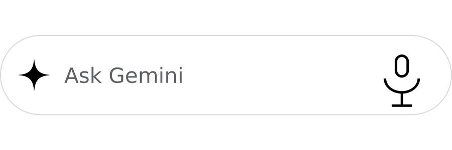

# Gemini Lite

A deliberately small, fast, unofficial Android client for [Gemini](https://gemini.google.com).
It is a tuned WebView shell that behaves like a native app: proper back navigation, a
clean Gemini page, cached sessions, a monochrome new-chat widget and a search-bar-style
widget that can start voice dictation straight from the home screen.

<p align="center">
  
</p>

> **Unofficial project.** Not affiliated with, endorsed by or sponsored by Google LLC.
> Gemini and Google are trademarks of Google LLC. Use at your own risk and comply with
> [Google's Terms of Service](https://policies.google.com/terms).

**Status:** v1.0 · Android 8.0+ (API 26) · ~2.7 MB APK · no analytics, no third-party runtime SDKs.

## Contents

- [Features](#features)
- [Widgets](#widgets)
- [Requirements](#requirements)
- [Build and install](#build-and-install)
- [Usage](#usage)
- [How it works](#how-it-works)
- [Project structure](#project-structure)
- [Customization](#customization)
- [Troubleshooting](#troubleshooting)
- [Privacy](#privacy)
- [Limitations](#limitations)
- [Changelog](#changelog)
- [Contributing](#contributing)
- [License](#license)

## Features

- **Native-feeling back navigation.** The system back gesture/button walks back
  through Gemini's history first and only then leaves the app. Predictive back is
  opted in (`android:enableOnBackInvokedCallback`), and an in-app auth popup closes
  before anything else.
- **Cleaner Gemini.** An injected page script hides paid-plan upsells ("Upgrade",
  "Try Gemini Advanced", model-upgrade CTAs), promo/announcement banners, and every
  "get the app" / QR-code / Play Store / App Store promo. Links to the official
  Gemini app stores are blocked, both in the page and at the navigation layer.
- **Fast and cached.** Chromium is pre-warmed behind the splash screen. The HTTP
  cache and DOM storage are on, cookies are flushed on pause so the session survives
  process death, rotation does not reload the page (`configChanges`), and the WebView
  state is saved/restored (`saveState`/`restoreState`).
- **Monochrome widgets.** A *New chat* widget and an *Ask Gemini* search-bar widget,
  both matching the black-on-white app icon.
- **Voice from the home screen.** The *Ask Gemini* widget's microphone opens a fresh
  conversation and starts Gemini's own dictation automatically; the keyboard stays
  closed. Tapping the rest of the bar opens a new chat with the composer focused and
  the keyboard raised.
- **Native details.** Edge-to-edge layout, status/navigation bar colors and icon
  contrast follow the actual page theme (including Gemini dark mode), external links
  open in the default browser, Google auth popups open in an in-app overlay, and a
  failed load shows a retry screen instead of a blank WebView.
- **Photo/file uploads.** Single and multiple selection from the Android Photo Picker
  or any file provider. Selected content is staged in the app cache before upload,
  which avoids the Photo Picker `content://` quirk in WebView renderers.
- **Working microphone.** Runtime `RECORD_AUDIO` plus the normal
  `MODIFY_AUDIO_SETTINGS` permission, which Chromium requires before it exposes an
  audio capture device to the page.
- **App shortcut.** Long-press the launcher icon → *New chat*, same behavior as the
  new-chat widget.

## Widgets

| Widget | Default size | Body tap | Microphone tap |
| --- | --- | --- | --- |
| **New chat** | 2×1 | New conversation, composer focused, keyboard open | — |
| **Ask Gemini** | 4×1 | Same as *New chat* | New conversation + Gemini dictation, no keyboard |

<p align="center">
  
  
</p>

Both widgets are monochrome (black on white), can be resized, and use the same app
mark as the adaptive launcher icon. The *Ask Gemini* bar is intentionally slim
(46 dp) and supports horizontal and vertical resizing. Layout/widget metadata live in
[`res/layout/widget_new_chat.xml`](app/src/main/res/layout/widget_new_chat.xml),
[`res/layout/widget_ask_gemini.xml`](app/src/main/res/layout/widget_ask_gemini.xml),
and the two `res/xml/*_widget_info.xml` files.

Add them from the launcher: long-press an empty spot → **Widgets** → **New chat** or
**Ask Gemini**.

## Requirements

| | |
| --- | --- |
| Android | 8.0 Oreo (API 26) or newer |
| SDK | Android SDK Platform 35 (AGP selects the required build-tools) |
| Java | JDK 17+ (JDK 21 recommended and tested) |
| Build tools | Gradle 9.8.2 (wrapper), Android Gradle Plugin 9.4.1 (built-in Kotlin) |
| Dependencies | AndroidX Core KTX, AndroidX Activity KTX; no other runtime libraries |

`minSdk 26`, `targetSdk 35`, `compileSdk 35`.

The project uses AGP 9's built-in Kotlin support, so there is no separate
`org.jetbrains.kotlin.android` plugin to apply.

## Build and install

From the repository root:

```bash
# Optional: point Gradle at a specific JDK
export JAVA_HOME=/path/to/jdk-21

./gradlew assembleDebug
```

The debug APK is written to:

```
app/build/outputs/apk/debug/app-debug.apk
```

Install it on a connected device:

```bash
./gradlew installDebug
# or
adb install -r app/build/outputs/apk/debug/app-debug.apk
```

Android Studio can open the project directly. It creates `local.properties` with your
SDK path; the file is intentionally ignored by Git. For command-line builds create it
yourself:

```properties
sdk.dir=/path/to/Android/Sdk
```

### Signing

- **Debug builds** are signed with the standard `~/.android/debug.keystore` when it
  exists (falling back to AGP's default debug signing otherwise). This keeps in-place
  `adb install -r` updates working, so the WebView cookie jar — and your Gemini login —
  survives reinstalls.
- **Release builds** are minified and resource-shrunk but have **no release signing
  config** in this repository. Add a `signingConfigs` block and keep your keystore and
  passwords out of Git (`*.jks`, `*.keystore` and `keystore.properties` are ignored).
  Use a `keystore.properties` file loaded from `app/build.gradle.kts`, or CI secrets.

### Release build

```bash
./gradlew assembleRelease
```

Output: `app/build/outputs/apk/release/`. The included ProGuard rule keeps the
JavaScript bridge method names (`GeminiWebView$JsBridge`).

## Usage

- The app opens directly into `https://gemini.google.com/app`. There is no toolbar,
  URL bar or tab strip.
- **Sign in** with Google. The app sends a regular Chrome Android user agent (the
  WebView `wv` marker is stripped) to reduce Google's embedded-WebView sign-in
  blocking. Google still makes the final call; see [Limitations](#limitations).
- **Back gesture/button:** an open auth popup closes first, then in-page Gemini
  history is walked back, then the app exits.
- **Links:** Gemini and Google auth/support hosts stay in the app; everything else
  opens in your default browser.
- **Attachments:** use Gemini's `+` menu as usual. Single and multiple photos/files
  are supported.
- **Microphone:** tap Gemini's mic button. The first time, Android asks for microphone
  access; choose *While using the app* so the grant does not expire as a one-time
  permission.
- **Widgets and shortcut:** see [Widgets](#widgets).

## How it works

### WebView shell

[`GeminiWebView.kt`](app/src/main/java/com/frank/geminilite/GeminiWebView.kt) is a
`WebView` subclass that configures JavaScript, DOM storage, HTTP caching, a
Chrome-like user agent, safe browsing, mixed-content blocking, popup support and the
`GeminiHost` JavaScript bridge.

- `GeminiClient` keeps Gemini/Google auth hosts inside the app, sends other `http(s)`
  links to the browser, blocks Play Store/App Store links for the official Gemini app,
  reports main-frame errors, and recovers from renderer crashes.
- `GeminiChromeClient` provides file chooser, microphone permission, popup
  (`window.open`) and geolocation handling.
- External `intent://`, `market://`, `mailto:` and similar URLs are handed to the
  system.

[`MainActivity.kt`](app/src/main/java/com/frank/geminilite/MainActivity.kt) owns the
activity lifecycle, window insets, back dispatch, pickers, in-app auth popups, theme
application and widget intents.

### Back navigation

A single `OnBackPressedCallback` handles everything:

1. Close an open auth popup, if any.
2. `WebView.goBack()` if there is history.
3. Finish the activity.

The activity is `singleTask` and declares `configChanges` for orientation, screen size,
UI mode and density, so rotating the device does not reload Gemini. Widget intents are
delivered through `onNewIntent`.

### Edge-to-edge and theme sync

The activity calls `enableEdgeToEdge()` and applies system-bar/IME insets to the root
container. After a Gemini page loads, the injected script reads the page background
color and reports it through the `GeminiHost.theme(dark, r, g, b)` bridge. The activity
then updates the window background, error screen and system-bar icon contrast. This
keeps the status/navigation bars visually part of Gemini in both light and dark themes,
including when the user changes Gemini's own appearance setting.

### Caching and startup

- [`GeminiLiteApp`](app/src/main/java/com/frank/geminilite/GeminiLiteApp.kt) creates a
  throwaway WebView during `Application.onCreate`, while the system splash is still
  visible, to warm up Chromium.
- `cacheMode = LOAD_DEFAULT`, DOM storage and third-party cookies are enabled.
- Cookies are flushed in `onPause()` so the session survives task death.
- `WebView.saveState()` / `restoreState()` restore the page and history after process
  death; rotation and most configuration changes do not recreate the activity.
- WebView debugging is enabled in debug builds only.

There is no custom HTTP cache layer — Gemini's assets are served from Chromium's own
disk cache.

### Clean Gemini page

[`gemini.js`](app/src/main/assets/gemini.js) is injected on page commit and page
finish. It is idempotent and runs again only to rescan.

- **CSS hiding** covers known Gemini promo elements: `desktop-get-app-button`,
  `g1-dynamic-upsell-button`, `upsell-button`, `.adv-upsell`,
  `.upgrade-container`, `.announcement-banner-container`, `.gem-banner-container`,
  `[data-test-id*="upgrade"]`, Gemini Play Store/App Store links, and more.
- **Text heuristics** catch renamed/new elements by their wording (English and Polish
  patterns): "Upgrade to Google AI…", "Try Gemini Advanced", "Get the app",
  "Open in app", "Scan the QR code", "Pobierz aplikację", etc.
- A throttled `MutationObserver` plus a 3-second safety scan handles Gemini's SPA
  re-renders without scanning on every streamed token.
- Elements inside model responses, the composer, navigation and main content are
  protected; the script never hides conversation content or the input box.
- Clicking a store link for the official Gemini app is cancelled in-page and blocked
  by the native navigation policy.
- An "Upgrade" text inside a response is left alone: matching is limited to
  interactive/promo UI.

If a future Gemini UI change slips through, update the `CSS`, `APP_RES` and
`UPGRADE_RES` lists near the top of `gemini.js`. No other code needs to change.

### Composer focus and keyboard

`gemini.js` exposes `window.__gl.focus()`, which locates Gemini's contenteditable
composer, places the caret at the end and asks the native shell for the IME through
`GeminiHost.keyboard()`. Gemini re-renders its composer shortly after load, so the
focus helper re-asserts focus for a short window instead of assuming one focus call
sticks. The native side retries `showSoftInput()` a few times.

### File uploads

Two WebView issues are handled explicitly:

1. `FileChooserParams.parseResult()` returns `null` for the Android Photo Picker,
   because the picker delivers picks in `ClipData` instead of `Intent.getData()`.
   The app reads both forms itself.
2. WebView renderers often cannot read the Photo Picker's `content://` URIs (the
   preview becomes a broken image). The app stages the selected bytes in
   `cache/uploads` on a background thread and passes local `file://` URIs to WebView.
   Files older than 24 hours are cleaned on startup.
   `allowFileAccess` is enabled for this; `allowFileAccessFromFileURLs` and universal
   access remain disabled.

### Microphone and dictation

Chromium will not enumerate an audio capture device unless the app declares **both**
`RECORD_AUDIO` and `MODIFY_AUDIO_SETTINGS`. The app declares both and requests the
runtime `RECORD_AUDIO` permission when Gemini calls `getUserMedia()`. While the
permission dialog is up, the WebView is not paused, so the pending media request is not
cancelled. After the grant, `PermissionRequest.grant(RESOURCE_AUDIO_CAPTURE)` starts
the microphone.

The `Ask Gemini` widget's microphone uses `ACTION_ASK_VOICE`. The activity opens a
fresh `/app` page, then asks the page script to find and click Gemini's dictation
button. `gemini.js` recognizes the button across locales (`dyktuj`, `dictate`,
`microphone`, `mikrofon`, `voice input`, …), waits for up to 12 seconds and avoids
clicking a "Stop dictation" control. No separate speech-recognition service is used:
Gemini's own dictation UI does the work.

### Widgets

Two `AppWidgetProvider`s build monochrome `RemoteViews`:

- [`NewChatWidgetProvider.kt`](app/src/main/java/com/frank/geminilite/NewChatWidgetProvider.kt)
  — white pill, black spark and "New chat"; opens `ACTION_NEW_CHAT`.
- [`AskGeminiWidgetProvider.kt`](app/src/main/java/com/frank/geminilite/AskGeminiWidgetProvider.kt)
  — white search bar with the app mark, "Ask Gemini" and an outlined microphone. The
  body opens `ACTION_NEW_CHAT`; the microphone sends `ACTION_ASK_VOICE`.

Both use the shared [`WidgetIntents.kt`](app/src/main/java/com/frank/geminilite/WidgetIntents.kt)
to create distinct immutable `PendingIntent`s. The widgets are declared in
[`AndroidManifest.xml`](app/src/main/AndroidManifest.xml) and their metadata lives in
`res/xml/`. Widgets update only when needed (`updatePeriodMillis=0`).

## Project structure

```
.
├── app/
│   ├── build.gradle.kts                 app module, SDK levels, debug signing, R8
│   ├── proguard-rules.pro               keeps the JavaScript bridge methods
│   └── src/main/
│       ├── AndroidManifest.xml          permissions, activity, widgets, shortcut
│       ├── assets/gemini.js             injected cleanup/focus/dictation/theme script
│       ├── java/com/frank/geminilite/
│       │   ├── GeminiLiteApp.kt          Chromium warm-up, debug WebView flag
│       │   ├── MainActivity.kt           lifecycle, insets, back, pickers, theme, intents
│       │   ├── GeminiWebView.kt          configured WebView, clients, JS bridge, popups
│       │   ├── Injection.kt              cached asset loading + JS command strings
│       │   ├── NewChatWidgetProvider.kt  "New chat" widget
│       │   ├── AskGeminiWidgetProvider.kt "Ask Gemini" search/voice widget
│       │   └── WidgetIntents.kt          shared widget PendingIntents
│       └── res/
│           ├── drawable/                 widget surfaces, spark, mic, icon vectors
│           ├── drawable-nodpi/           widget picker preview images
│           ├── layout/                   activity + both widget layouts
│           ├── mipmap-*/                 monochrome adaptive launcher icon
│           ├── values/                   strings, colors, theme, icon background
│           ├── values-night/             dark window background
│           ├── values-v31/               Android 12+ splash screen
│           └── xml/                      widget metadata, static shortcut
├── gradle/
│   ├── libs.versions.toml               version catalog (AGP, AndroidX)
│   └── wrapper/                          Gradle 9.8.2 wrapper
├── build.gradle.kts
├── settings.gradle.kts
├── gradle.properties
├── gradlew / gradlew.bat
├── LICENSE
└── README.md
```

## Customization

### App name

Change `app_name` in [`res/values/strings.xml`](app/src/main/res/values/strings.xml).
Widget labels are `widget_name`, `widget_label`, `widget_ask_name` and
`widget_ask_label` in the same file.

### Package / application ID

To rename from `com.frank.geminilite`:

1. Change `namespace` and `applicationId` in [`app/build.gradle.kts`](app/build.gradle.kts).
2. Refactor the Kotlin package (Android Studio: **Refactor → Rename**) and update
   imports.
3. Update the explicit package/class in
   [`res/xml/shortcuts.xml`](app/src/main/res/xml/shortcuts.xml)
   (`android:targetPackage`, `android:targetClass`).
4. Update the custom action strings in `MainActivity` if you want them namespaced to
   the new ID (they are only used internally, but keeping them consistent avoids
   collisions).
5. Update the ProGuard rule in [`app/proguard-rules.pro`](app/proguard-rules.pro) if
   the `GeminiWebView$JsBridge` class moves.
6. Rebuild and reinstall (the debug signature changes only if the keystore changes).

### Icon

The launcher icon is an adaptive icon: background color in
`res/values/ic_launcher_background.xml`, foreground/monochrome WebP mipmaps under
`res/mipmap-*`. Replace it with Android Studio's **Image Asset** tool, or swap the
drawables. The widgets deliberately use their own black [`ic_spark.xml`](app/src/main/res/drawable/ic_spark.xml)
and [`ic_mic.xml`](app/src/main/res/drawable/ic_mic.xml), so changing the launcher icon
does not automatically change the widgets.

### Widget look and size

- Surfaces: [`widget_background.xml`](app/src/main/res/drawable/widget_background.xml)
  and [`widget_search_background.xml`](app/src/main/res/drawable/widget_search_background.xml).
- Black/white palette: `widget_surface`, `widget_outline`, `widget_text`,
  `widget_hint` in `res/values/colors.xml`.
- Sizes and resize behavior: `res/xml/new_chat_widget_info.xml` and
  `res/xml/ask_gemini_widget_info.xml` (`minWidth`, `minHeight`, `minResize*`,
  `targetCell*`, `resizeMode`).
- Picker previews: `res/drawable-nodpi/widget_preview.png` and
  `widget_search_preview.png`.

### Start URL and browser behavior

- Start URL: `GeminiWebView.HOME_URL`.
- Allowed in-app hosts and store-link blocking: `isInternalUri` / `isBlockedStoreUri`
  in `GeminiWebView.kt`.
- User agent: `chromeLikeUserAgent()` in the same file.

### Hiding more (or less)

Edit [`gemini.js`](app/src/main/assets/gemini.js):

- `CSS` — selectors hidden immediately.
- `APP_RES` — text patterns for "get the app"/install promos.
- `UPGRADE_RES` — text patterns for paid-plan upsells.
- `CONTENT_PROTECT` — selectors that must never be hidden (conversation and composer).
- `MIC_SELECTORS` / `STOP_DICTATION_RE` — dictation button detection.

Rebuild the APK after editing the packed asset.

## Troubleshooting

**"This browser or app may not be secure" during Google sign-in.**
Google sometimes blocks sign-in from embedded WebView clients. The app sends a
Chrome-like Android user agent to reduce this, but it cannot override Google's decision.
If the account is blocked in WebView, this client cannot sign that account in; there is
no reliable in-app workaround.

**The microphone does nothing.**
Check that *Gemini Lite* has microphone permission (Settings → Apps → Gemini Lite →
Permissions → Microphone) and choose *While using the app* rather than *Only this time*.
The one-time session can expire when the app goes to the background. Also check the
system microphone privacy toggle/Quick Settings. The app already declares the
`MODIFY_AUDIO_SETTINGS` permission Chromium requires.

**Photos/files don't attach.**
Try a standard JPEG or PNG first. Very large files take longer because they are copied
into the app cache before upload. The staging directory is cleaned after 24 hours; no
manual cleanup is needed.

**A widget still looks old or cannot be resized.**
Launchers cache widget layouts and resize handles. Remove the widget and add it again
from the widget picker. On Android 12+ the picker shows the live `previewLayout`.
Resizing support depends on the launcher.

**The New chat widget opens but the keyboard is missing.**
Wait a second longer on slower devices while Gemini hydrates, or tap the composer once.
The focus helper keeps re-asserting focus for a few seconds, but some keyboards are slow
to attach.

**A promo/ad still appears.**
Gemini's markup changes often. Add the element selector to `CSS` or its wording to
`APP_RES`/`UPGRADE_RES` in `gemini.js`, then rebuild. Please open an issue with a
screenshot and the element's HTML if possible.

**Blank page or "Can't reach Gemini".**
Check the connection and tap **Retry**. The retry screen is shown instead of an empty
WebView for main-frame network errors. Clearing app data logs you out of Gemini.

**Build fails about the JDK.**
Use JDK 17 or newer, preferably JDK 21:
`export JAVA_HOME=/path/to/jdk-21`. AGP 9.4.1 and Gradle 9.8.2 both work with JDK 21.

**`SDK location not found`.**
Create `local.properties` with `sdk.dir=/path/to/Android/Sdk`, or open the project in
Android Studio. Install Android SDK Platform 35 and accept the SDK licenses.

## Privacy

- **No analytics, crash reporting, ads or tracking SDKs.** The app contains no
  developer-operated backend.
- The only network traffic is the Gemini website and its Google-hosted resources.
  Google's own [Privacy Policy](https://policies.google.com/privacy) and Gemini terms
  apply to that traffic.
- The WebView cookie jar, local storage and cached files live in the app's private data
  directory. Cookies are flushed locally on pause so the session survives.
- Attachment bytes are copied to `cache/uploads` solely so WebView can read them; the
  directory is pruned after 24 hours.
- The `GeminiHost` JavaScript bridge exposes only two methods: report the page theme
  and ask for the keyboard. No personal data or file contents pass through it.
- The app requests `INTERNET`, `ACCESS_NETWORK_STATE`, `RECORD_AUDIO` and
  `MODIFY_AUDIO_SETTINGS`. It does not request storage, contacts, location or camera
  access. Cleartext HTTP is disabled.
- This is an independent project; the only data controller for Gemini content is
  Google.

## Limitations

- **Unofficial and fragile by nature.** Gemini is a changing web app; selectors and
  dictation behavior can break after a Google update.
- **Google sign-in in WebView** can be refused by Google. There is no guaranteed
  workaround.
- **No downloads UI.** Links are followed and pages render, but the app does not
  implement a download manager for Gemini-generated files.
- **No push notifications, tabs, history manager, bookmarks or offline mode.**
- **Dictation depends on Gemini's UI.** The widget clicks Gemini's own microphone
  button; if Google removes or relabels it, update `MIC_SELECTORS` in `gemini.js`.
- **Widgets are launcher-dependent.** Cell sizes, resize handles and previews vary by
  launcher/OEM.
- **Not a Google product.** "Gemini" and "Google" are trademarks of Google LLC. The
  app's name/package are not endorsed by Google.

## Changelog

### 1.0 — 2026-11-13

- Initial public release: WebView Gemini client with predictive back, theme-aware
  edge-to-edge layout, Chromium warm-up/caching and session persistence.
- Monochrome *New chat* widget and slim, resizable *Ask Gemini* search/voice widget.
- Page cleanup for paid-plan upsells and native-app download promos.
- Native Photo Picker uploads, including multiple selection.
- Working microphone/dictation with the required Chromium permissions.

## Contributing

Contributions are welcome.

1. Fork the repository and create a topic branch.
2. Keep the dependency footprint small and the app WebView-only (no Compose/analytics
   SDKs unless discussed first).
3. Build with `./gradlew assembleDebug` and test on a real device when possible,
   particularly back navigation, uploads, microphone and both widgets.
4. For Gemini UI changes, include the new selector and a short explanation in the PR.
5. Do not commit `local.properties`, `.gradle-home`, IDE files, keystores, signing
   passwords or captured personal data.

There is currently no automated test suite; widget/voice behavior needs a device.
Bug reports are most useful with: device model, Android version, WebView version,
launcher, steps to reproduce and a logcat snippet.

## License

[MIT](LICENSE) © 2026 Gemini Lite contributors.

## Acknowledgements

- [Gemini](https://gemini.google.com) by Google, for the web app this client wraps.
- [AndroidX](https://developer.android.com/jetpack/androidx) (Core, Activity) and the
  Android platform WebView.
- [Gradle](https://gradle.org/) and the
  [Android Gradle Plugin](https://developer.android.com/build).
- Gemini upsell-selector research informed by community userstyles/scripts:
  [gemini-cleaner](https://github.com/alexandrumld/gemini-cleaner),
  [Gemini Bloat Remover](https://userstyles.world/style/26970/gemini-bloat-remover-makeover-edition),
  [Gemini Hide Banners](https://userstyles.world/style/24197/default-slug),
  and the Greasy Fork "Gemini – Remove Upgrade & Download App buttons" script.
- The monochrome sparkle app icon and widget artwork in this repository.

---

*Gemini Lite is an independent project and is not affiliated with Google LLC.*
